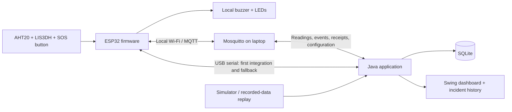

# SiteGuard

Smart construction helmet monitoring with an ESP32 and a Java desktop application.

**Status: planning.** This repository contains the system design and team delivery plan. The firmware, application, and measured results have not been implemented yet.

We will build one physical helmet that reports temperature, humidity, acceleration, and SOS events. A Java operator console will show device health and store incident records. Local helmet alarms will keep working when the laptop or network is unavailable.

## Project plan

| Document | What it covers |
| --- | --- |
| [Roadmap](docs/ROADMAP.md) | Build order, task owners, dependencies, and completion criteria |
| [System design](docs/SYSTEM_DESIGN.md) | Components, Java boundaries, incident states, and storage |
| [Message protocol](docs/PROTOCOL.md) | Shared firmware/Java contract and delivery rules |
| [Team plan](docs/TEAM_PLAN.md) | TL responsibilities, ownership, and team decisions |
| [Hardware plan](docs/HARDWARE.md) | Parts to obtain, assembly stages, and mounting |
| [Shopping list](docs/SHOPPING_LIST.md) | Exact models, retailer options, tools, spare parts, and budget limits |
| [Test plan](docs/TEST_PLAN.md) | Acceptance targets and the evidence needed to claim them |
| [Contributing](CONTRIBUTING.md) | Branches, pull requests, reviews, and integration |

## Team

| Member | Role |
| --- | --- |
| Ismoiljon Masharipov | Team lead; Java application, rules, dashboard, and integration |
| Jakhongir | Hardware and ESP32 firmware |
| Third member, to be confirmed | Proposed owner of persistence, simulation/replay, and test evidence |

Until the third member is confirmed, Ismoiljon owns that work and may split individual tasks with Jakhongir. Student IDs and course submission documents are kept outside this public repository.

## Planned system

The initial milestone uses USB serial. Wi-Fi/MQTT follows once the same reading can be traced from the sensor to a saved incident. Simulation uses the same Java processing path as hardware input.

## Demonstration goals

- Show live readings and an explicit stale or disconnected state when updates stop.
- Trigger SOS locally, save the incident in Java, then acknowledge and resolve it with a recorded note.
- Keep local SOS available during a network outage.
- Restart the application and recover incident history.
- Publish latency and fault-test results with their conditions. All current numbers in the [test plan](docs/TEST_PLAN.md) are targets.

## First team session

1. Confirm the third teammate and the professor's roster requirements.
2. Review the task ownership and baseline scope with Ismoiljon as TL.
3. Confirm the ESP32 and sensor board variants before ordering.
4. Agree on message protocol v1, then start tasks S01 and S02 in parallel.

No application run command is available yet. The first Java scaffold task will add a Maven wrapper, build instructions, and automated checks.

## Prototype limits

SiteGuard is a controlled demonstration prototype, not certified protective or emergency equipment. Mount electronics without drilling or cutting the helmet. Perform motion tests on an unworn prototype. Environmental readings do not establish safe working conditions, and motion events do not diagnose injuries or falls.

Only one physical device is planned. Any additional simulated devices and synthetic results must be labeled accordingly.
