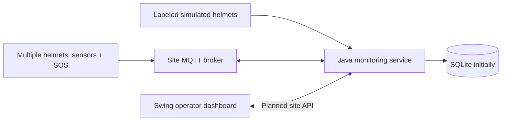

# SiteGuard

Smart construction helmet monitoring with an ESP32 and a Java desktop application.

**Status: early software prototype.** The Java desktop can run a labeled simulator with incident controls. Firmware, hardware integration, and physical measurements remain to be implemented and verified. No course-stage gate has been accepted yet.

SiteGuard targets a construction site with multiple workers and helmets. Each helmet is associated with a worker and reports nearby air temperature/humidity, motion, and SOS events to a central Java service and operator dashboard. Local helmet alarms should keep working when the network or server is unavailable. The course prototype will demonstrate one physical helmet alongside separately labeled simulated helmets; the current app still simulates only one.

The team lead reports ordering the [November 14 hardware selection](docs/SHOPPING_LIST.md): ESP32-S3 N16R8, AHT20/BMP280, LIS3DH, an active buzzer, and an external PBS-33B SOS button. The last reviewed checkout was KRW 40,142 with free shipping against a KRW 100,000 budget; the charged amount and delivery remain unverified. One spare ESP32 and one spare LIS3DH are included. Use owned/borrowed tools and verify the received clone's pinout before assembly. Ordering does not demonstrate a working feature.

## Project plan

| Document | What it covers |
| --- | --- |
| [Roadmap](docs/ROADMAP.md) | Build order, task owners, dependencies, and completion criteria |
| [Build stages](docs/BUILD_STAGES.md) | Small agent-ready implementation tasks, file ownership, and acceptance gates |
| [Development status](docs/DEVELOPMENT_STATUS.md) | Current prototype, parallel work, checks, limitations, and next steps |
| [Agent task template](docs/AGENT_TASK_TEMPLATE.md) | Copyable task prompt and reviewer handoff |
| [System design](docs/SYSTEM_DESIGN.md) | Components, Java boundaries, incident states, and storage |
| [Message protocol](docs/PROTOCOL.md) | Shared firmware/Java contract and delivery rules |
| [Team plan](docs/TEAM_PLAN.md) | TL responsibilities, ownership, and team decisions |
| [Hardware plan](docs/HARDWARE.md) | Installed parts, assembly stages, and mounting |
| [Shopping list](docs/SHOPPING_LIST.md) | Exact models, retailer options, tools, spare parts, and budget limits |
| [Test plan](docs/TEST_PLAN.md) | Acceptance targets and the evidence needed to claim them |
| [Contributing](CONTRIBUTING.md) | Branches, pull requests, reviews, and integration |

## Team

| Member | Role |
| --- | --- |
| Ismoiljon Masharipov | Team lead; Java application, rules, dashboard, and integration |
| Jakhongir | Hardware and ESP32 firmware |
| Third member, to be confirmed | Proposed owner of persistence, simulation/replay, and test evidence |

Until the third member is confirmed, Ismoiljon owns that work and may split individual tasks with Jakhongir. Student IDs and course submission documents are kept outside this public repository.

## Planned system

The initial milestone uses USB serial. Wi-Fi/MQTT follows once the same reading can be traced from the sensor to a saved incident. Simulation uses the same Java processing path as hardware input.

## Demonstration goals

- Show live readings and an explicit stale or disconnected state when updates stop.
- Trigger SOS locally, save the incident in Java, then acknowledge and resolve it with a recorded note.
- Keep local SOS available during a network outage.
- Restart the application and recover incident history.
- Publish latency and fault-test results with their conditions. All current numbers in the [test plan](docs/TEST_PLAN.md) are targets.

## First team session

1. Confirm the third teammate and the professor's roster requirements.
2. Review the task ownership and baseline scope with Ismoiljon as TL.
3. Check the order receipt privately; verify the delivered ESP32/sensor variants and separate spares when parts arrive.
4. Resolve A00's protocol/build decisions, then follow A01/A02 and the dependent Java stages. Start A08 bench work once the hardware and tools are available.

For Windows run instructions, see [desktop/BUILD.md](desktop/BUILD.md). The offline launcher needs JDK 17 and runs the simulator without persistent history. Maven and its dependencies are needed to build the SQLite-enabled package.

## Prototype limits

SiteGuard is a controlled demonstration prototype, not certified protective or emergency equipment. Mount electronics without drilling or cutting the helmet. Perform motion tests on an unworn prototype. Environmental readings do not establish safe working conditions, and motion events do not diagnose injuries or falls.

The current order supports one physical helmet and spare boards, not a fleet. Multi-worker monitoring and the central service are planned and unverified. Simulated helmets and results must be labeled. The ordered AHT20 measures nearby air temperature and humidity, not core body temperature. GPS is not included.
