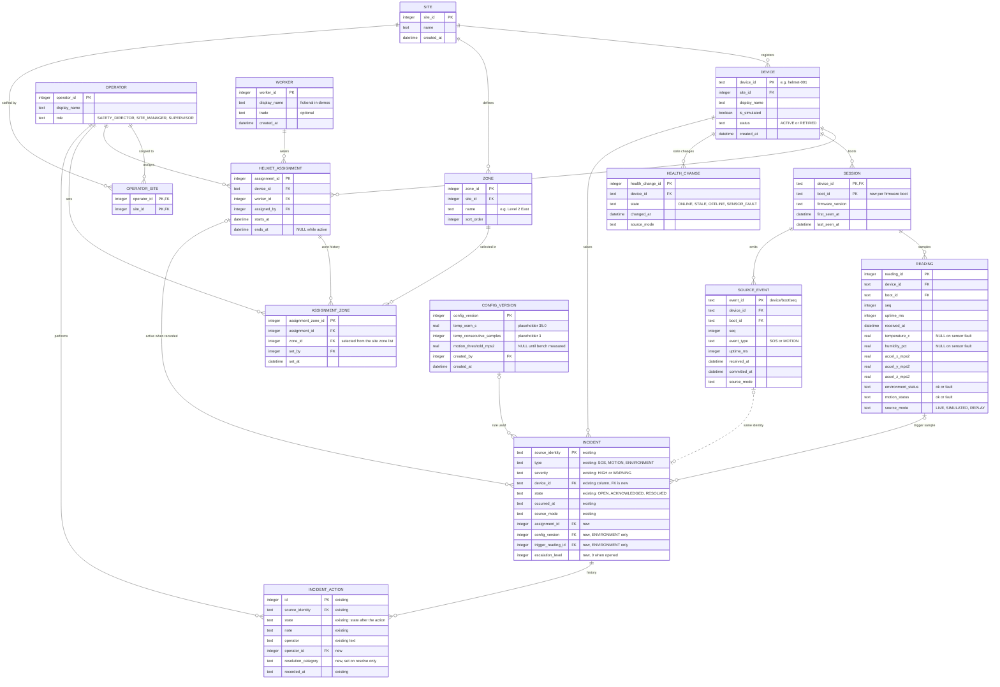
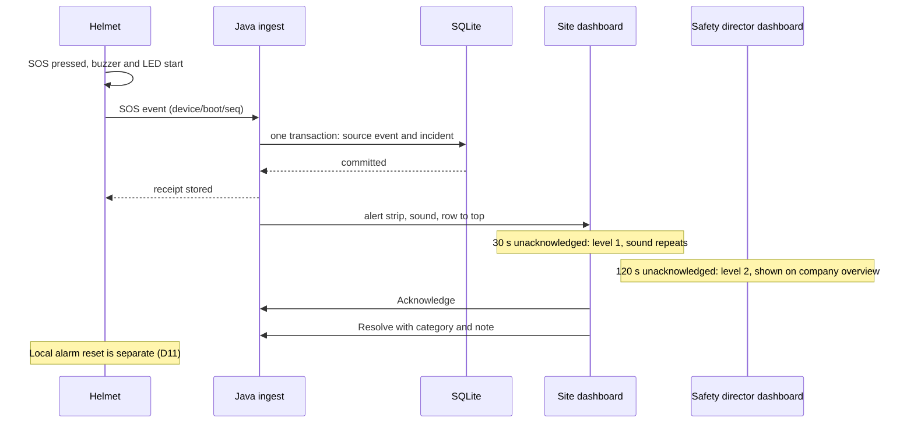
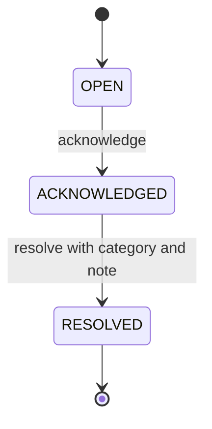

# SiteGuard build brief (single file for a dev agent)

Prepared 2026-11-18 for Ismail (team lead). Merges the A00 decision draft, data model, manager dashboard and workflows, protocol fixtures, and stage-card amendments.

## Instructions for the agent

1. In the repo, read `AGENTS.md`, `docs/BUILD_STAGES.md`, `docs/PROTOCOL.md`, `docs/SYSTEM_DESIGN.md` first. This brief adds to them. If it conflicts with `docs/PROTOCOL.md` on the wire format, the repo wins; report the conflict to the TL.
2. Work on **one stage card at a time** (Part 5 lists what changes per stage). State the files you expect to change and the checks you will run before editing. Stay inside the stage scope.
3. Build only items marked **ACCEPTED**. Items marked **PROPOSED** need the TL (Ismail) to accept them first. Ask; do not assume.
4. Never claim a check ran or a measurement exists unless you ran it. Label simulation and replay. No fabricated latency, screenshots, or hardware results.
5. Do not push, merge, flash hardware, change wiring, or buy anything unless the active task says so. Keep credentials, local databases, and device captures out of commits.
6. Swing updates run on the event thread; serial, network, database, and file I/O run off it. Domain and application code must not import Swing, MQTT, serial, or JDBC.
7. Current prototype facts: Maven project in `desktop/`, JDK 17 today (moving to JDK 21, D1), SQLite schema `user_version` 2 with tables `incidents` and `incident_actions`, one simulated helmet, no central service, no worker assignments, no firmware. Hardware is on order and not yet verified.

## What is accepted today

| Decision | Result |
|---|---|
| D1 | JDK 21 (LTS) |
| D9 | Environment rule: 35 °C for 3 consecutive samples, as placeholders until bench measurement |
| D10 | Motion threshold measured in A08; empty until then |
| D11 | Local SOS alarm latches until a deliberate hold of the SOS button |
| D13 | Local SQLite file on the server machine, fictional data |
| D14 | Readings stored at most 1 Hz; keep all demo data, no purge |

Everything else in Part 1 is **PROPOSED** until the TL changes it to ACCEPTED. TL: edit the Accepted column in Part 1 before handing this to an agent.

---

# Part 1. Decisions (A00)

Status: **partly accepted.** Accepted by Ismail (TL) in chat on 2026-11-18: D1, D9, D10, D11, D13, D14. Remaining decisions are pending review. Firmware owner review: _pending (Jakhongir)_.

Nothing below is a measured result. Thresholds are placeholders until A08 bench checks and A05 tests exist.

### Decisions

| # | Decision | Recommendation | Options | Accepted |
|---|---|---|---|---|
| D1 | Java release | **JDK 21 (LTS)**. The prototype and offline launcher currently build on JDK 17, so A01 must change `desktop/pom.xml` and the launcher, and every laptop needs JDK 21. | JDK 17 | Ismail, 2026-11-18 (chat) |
| D2 | Package root | `com.siteguard` (already used) | none | |
| D3 | Build | Maven wrapper in `desktop/` (already present) | Gradle | |
| D4 | Firmware toolchain | Arduino-ESP32 core, as in the proposal; confirm in A08 | PlatformIO | |
| D5 | Course transport order | USB serial first, then MQTT (A09 before A11/A12) | MQTT first | |
| D6 | Wire protocol | `docs/PROTOCOL.md` v1 as drafted, with fixtures in `fixtures/protocol/` | none | |
| D7 | Telemetry rate | About 1 Hz (protocol); motion sampled separately and faster | per-sample storage | |
| D8 | Stale device | No valid reading for 5 s; refreshed at least 1 Hz (meets the 6 s proposal target) | 6 s directly | |
| D9 | Environment rule (placeholder) | Temperature at or above 35 °C for 3 consecutive samples, from `DEVELOPMENT_STATUS.md`. Build and test with this; set real values from A08 bench measurements. Recovery rule: A05 proposes. | Lock these values | Ismail, 2026-11-18 (chat): placeholders now, measure later |
| D10 | Motion rule (placeholder) | Single sample above a threshold measured in A08 (stored as NULL until then); labelled "sudden movement", never "fall" | Sustained window | Ismail, 2026-11-18 (chat): measure later |
| D11 | Local alarm reset | SOS latches until a deliberate hold on the helmet's SOS button; hold duration chosen in A08 | Auto-clear after fixed time | Ismail, 2026-11-18 (chat) |
| D12 | Remote acknowledgement | Never silences the local alarm (protocol rule) | Silence on acknowledge | |
| D13 | Storage | Local SQLite file on the server machine, same JVM as the Java app for the course demo. Demo data is fictional. | Separate service now | Ismail, 2026-11-18 (chat) |
| D14 | Stored telemetry and retention | Readings stored at most 1 Hz; fast motion sampling never stored continuously. Keep all demo data, no automatic purge. | Purge after N days | Ismail, 2026-11-18 (chat) |
| D15 | Receipt | Firmware gets `stored` only after the event and its incident commit (protocol rule) | Receipt on arrival | |
| D16 | Helmet Wi-Fi | See the network section below | | |
| D17 | Operator identity (single-process demo) | Operator picks a name from a list, no password; password login when the service is split (A11B) | Password login now | |
| D18 | Data model | Part 2 v3: adds site, zone, operator, assignment zone, health change, config version tables to the two existing ones | Keep two tables until A07B | |
| D19 | Manager dashboard | Site-scale screens and workflows in Part 3 v3 (zones, exceptions first, shift report, company overview as design only) | none | |
| D20 | SOS escalation (proposal) | Unacknowledged SOS: level 1 at 30 s, level 2 at 120 s; on-screen and sound only. Values are placeholders. | No escalation | |
| D21 | Resolution categories (proposal) | False alarm, Test, Assistance given, No action needed, Other; required when resolving | Note only | |
| D22 | Roles (proposal) | SAFETY_DIRECTOR (all sites), SITE_MANAGER and SUPERVISOR (assigned sites) | Two roles | |
| D23 | Zones | Zone list defined per site; operators select a zone for each assignment. No automatic location, no GPS. | Free-text zone | |

### Helmet network connection

- **Radio:** ESP32-S3 Wi-Fi is 2.4 GHz only. Use a 2.4 GHz network with WPA2 or WPA3-Personal. No open networks, no enterprise Wi-Fi.
- **Demo network:** a router or phone hotspot, with the helmet and the laptop on the same subnet. The laptop gets a fixed address (DHCP reservation, or the hotspot address written down at the start of the test).
- **Credentials, course demo:** firmware reads `firmware/secrets/wifi_config.h` containing SSID, password, broker host, port, and per-device MQTT username and password. The existing `secrets/` rule in `.gitignore` covers it. Never commit it.
- **Credentials, later (not in the course baseline):** a setup page hosted by the helmet, storing values in flash. Needs a separate decision before any work.
- **Connection behaviour:** retry with backoff. Buzzer and LED alarms never wait for Wi-Fi, a broker, or Java. Sampling and the button loop never block on the network.
- **Broker:** Mosquitto on the laptop, with authentication. Anonymous access is not allowed.
- **Coverage:** one helmet, one access point. The report states this limit. Site-wide coverage is out of scope.

### Fixtures

Files in `fixtures/protocol/`. All are synthetic (`"simulated": true`).

| File | Expected outcome |
|---|---|
| `telemetry_valid.json` | Accepted as a valid reading |
| `telemetry_environment_fault.json` | Accepted; environment marked faulty; no substituted values |
| `event_sos.json` | Accepted; one SOS event identity |
| `receipt_stored.json` | Accepted by firmware as a durable receipt for the matching event |
| `invalid_humidity.json` | Rejected: humidity 120 is outside 0–100 |
| `invalid_version.json` | Rejected: unsupported `schema_version` |

### Roster

The guidelines require 3–4 members. Ismail reported on 2026-11-18 (chat) that the roster/instructor approval for a smaller team is approved. This is the TL's report; it is not verified here. Keep the instructor's message. Roster status in `ROADMAP.md` and `TEAM_PLAN.md` is not changed by this draft.

### Open items

1. Accept or change the remaining decisions and record them in the table.
2. Jakhongir signs off on the firmware-side decisions D4, D7, D11, D15, and §Helmet network connection.
3. Open items listed at the end of Part 2 (OFFLINE definition, ENVIRONMENT recovery rule).

---

# Part 2. Data model

Status: **draft for TL review.** Extends the storage plan in `docs/SYSTEM_DESIGN.md`. Source identities follow `docs/PROTOCOL.md`. Wire fields are unchanged. v3 adds site zones, operator site scoping, escalation, and resolution categories, based on the patterns in Part 3.

### Scope

- One database per site server. Single company; several sites are possible because helmets, zones, and operators belong to a site. Only one site is built for the course.
- Course demo: one Java process (ingest, rules, storage, Swing dashboard) with a local SQLite file on the server machine. A separate site service comes later, after the single-process path passes its tests.
- All demo data is fictional. Retention: keep everything, no automatic purge (see Part 1). The database file lives in the ignored `data/` folder.
- Designed for a site with many workers (lists, zones, filters, paging). The repo requires at least ten simulated identities; any larger number is a test target, not a claim.

### What exists today

The prototype's schema (`user_version` 2) has two tables only:

| Table | Columns today |
|---|---|
| `incidents` | `source_identity` (PK), `type`, `severity`, `device_id`, `state`, `occurred_at`, `source_mode` |
| `incident_actions` | `id` (PK), `source_identity` (FK), `state`, `recorded_at`, `operator`, `note` |

Everything else in the ERD is **new** and would arrive as numbered migrations (version 3 and up). Names keep the existing ones: types `SOS`, `MOTION`, `ENVIRONMENT`; severities `HIGH` (SOS) and `WARNING`; identity column `source_identity`.

### ERD



Composite keys cannot be drawn fully in Mermaid; see Constraints. `OPERATOR` has no credentials in this version.

### Constraints

| Table | Constraint |
|---|---|
| `READING` | `UNIQUE (device_id, boot_id, seq)`; `(device_id, boot_id)` references `SESSION` |
| `SOURCE_EVENT` | `event_id` is the protocol identity `device/boot/seq`; `UNIQUE (device_id, boot_id, seq)`; `committed_at` set in the same transaction as the resulting incident |
| `INCIDENT` | `source_identity` is the primary key. For SOS/MOTION it equals `SOURCE_EVENT.event_id`. For ENVIRONMENT it is a rule identity such as `device/boot/ENVIRONMENT/seq` of the sample that completed the condition |
| `HELMET_ASSIGNMENT` | Partial unique indexes: one row per `device_id` where `ends_at IS NULL`, and one per `worker_id` where `ends_at IS NULL` |
| `ZONE` | `UNIQUE (site_id, name)` |
| `OPERATOR_SITE` | Composite primary key `(operator_id, site_id)`. A SAFETY_DIRECTOR sees all sites; the other roles see only their rows here |
| `ASSIGNMENT_ZONE` | Append-only; the current zone is the latest row per assignment; the zone must belong to the same site as the device |
| `INCIDENT_ACTION` | Append-only: triggers block `UPDATE` and `DELETE`. `resolution_category` is required on the resolving action and must be one of `FALSE_ALARM`, `TEST`, `ASSISTANCE_GIVEN`, `NO_ACTION_NEEDED`, `OTHER` |
| All connections | `PRAGMA foreign_keys = ON` (already set in the prototype) |
| Schema changes | Numbered migrations, version 3 and up |

### Rules

- Incidents keep the assignment active when they were recorded. Reassigning never relabels old incidents. An unassigned helmet has `assignment_id` NULL.
- A new assignment and the end of the previous one (helmet's and worker's) happen in one transaction.
- Incident state flow is the repo's: `OPEN → ACKNOWLEDGED → RESOLVED`. No skipping, no reopening. Notes are new action rows.
- `escalation_level` rises only while an incident is unacknowledged (timers in Part 3); it never changes state and is recorded for reports.
- Device health (`HEALTH_CHANGE`) is separate from incidents. Stale, offline, and sensor fault never create or resolve an incident.
- ENVIRONMENT incidents store the config version and triggering reading as evidence. While one is unresolved for a device, further violating samples add no incident (proposal; A05 confirms).
- Zone is selected by an operator from the site's list, with time and who set it. It is not tracking and is never shown as live location.
- Readings are stored at most once per second (the 1 Hz telemetry, including acceleration). Fast motion sampling is never stored continuously; it only produces MOTION events.
- Reports derive "helmet online time" from stored readings and health changes. It shows the helmet was reporting, not that the worker was present.
- Latency is measured on the ESP32 only. Never subtract laptop and device clocks.
- Simulated and replayed rows carry `source_mode` and never mark a physical helmet live.
- The receipt is sent only after the event and incident commit.

### Not in the protocol, therefore not modelled

Battery level, automatic location, worker identity on the helmet, certifications. Each needs a separate decision and a `PROTOCOL.md` or schema change first.

### Open decisions

1. Operator identity for the single-process demo: pick a name from a list (no password). Password login when the service is split (A11B).
2. OFFLINE definition: transport lost versus no data for longer than STALE. A05 to propose.
3. ENVIRONMENT recovery rule and the "condition cleared" notice. A05 to propose.
4. Escalation timers and resolution categories are proposals (D20, D21).

---

# Part 3. Manager dashboard and workflows

Status: **draft for TL review.** Swing supervisor application per `docs/SYSTEM_DESIGN.md`; data from Part 2. Demo data is fictional; simulated helmets show `SIM`.

### Design basis

Patterns taken from public descriptions of real connected-worker and construction-safety products (Triax Spot-r, WakeCap, Guardhat, Honeywell Safety Suite, Kenzen, Procore Safety Hub; list at the end). Their full UIs were not available, so this takes their structure and workflows, not their screens or branding.

| Pattern in real products | Used here |
|---|---|
| Site-wide headcount by floor/zone, not one card per worker | Zone list with counts; worker table filtered by zone |
| Exceptions first: alarms and problems on top | Alert strip, then "needs attention" sort |
| Device-to-worker assignment managed centrally | People and helmets screen, bulk assignment at shift start |
| Incident record: severity, who is alerted, follow-up, trends with drill-down | Incident detail, resolution category, report with drill-down |
| Incident playback after an event | Stored readings 5 min before and after (1 Hz only) |
| Escalating alerts if nobody responds | Escalation levels on unacknowledged SOS |
| Company level above project/site level; multi-site | Company overview (design only; one site built) |
| Scheduled or on-demand reports | Shift report with CSV export |
| Role-based access per site | Three roles scoped by site |

**Not matched:** automatic worker location (those products use mesh beacons or similar); our zone is selected by an operator. No GPS was ordered. SMS/email notifications and evacuation broadcast are outside the baseline.

### Scale

The layout is built for hundreds of workers: counts and zones first, a paged and filterable table, no card per helmet. The repo requires a test with at least ten simulated identities. Any larger count is a target to measure, not a claim.

### Roles (proposal, D17/D22)

| Role | Scope | Can do |
|---|---|---|
| SAFETY_DIRECTOR | All sites | View everything, company overview, reports, change thresholds |
| SITE_MANAGER | Assigned sites | Everything at their site: register workers/helmets/zones, assign, handle incidents, reports |
| SUPERVISOR | Assigned sites | View, assign helmets, set zone, acknowledge/note/resolve, export |

Nobody can silence a helmet's local alarm or disable its SOS button remotely.

### Status vocabulary

| Status | Meaning |
|---|---|
| ONLINE | Valid live reading within the last 5 s |
| STALE | No valid reading for 5 s or more |
| OFFLINE | Transport lost (exact definition: open item) |
| SENSOR FAULT | A sensor reports fault; value `--`, never an old value |
| NO DATA YET | Assigned, nothing received since assignment |
| UNASSIGNED | Helmet registered, no worker |

Text label plus color, never color alone. Temperature is **air temperature near the helmet**, not body temperature. MOTION means sudden movement over the demo rule, not a fall or injury. Zone shows who selected it and when; a zone set before the shift started is flagged.

### Workflows

#### W1. Set up (site manager, once)
1. Register site, zones (names), helmets (`device_id`, label), workers (fictional name, trade), and operators with their roles and sites.
2. Helmet credentials live in broker configuration, not in the database.

#### W2. Start of shift (supervisor)
1. Open People and helmets. Select a worker and helmet, or paste a list of pairs. Typing or scanning a `device_id` into the field works (a keyboard-style scanner is a later option).
2. Select each worker's zone.
3. One transaction ends earlier assignments for that helmet and worker and starts the new one. Cards show NO DATA YET until the first valid reading.

#### W3. Monitoring
Readings about once per second. Java validates, stores at most 1 Hz, updates the overview. Sort "Needs attention": open SOS, then OFFLINE/STALE/SENSOR FAULT, then open warnings, then the rest.

#### W4. SOS with escalation (timers are placeholders, D20)



If the commit fails, no receipt is sent and the dashboard shows a storage fault. The helmet alarm keeps running.

#### W5. Environmental warning
Java rule creates one ENVIRONMENT incident after the configured consecutive samples. Acknowledge, then resolve with category and note. No new incident while one is unresolved for that helmet. When readings return to normal the dashboard shows "condition cleared" (recovery rule: A05).

#### W6. Stale or offline helmet
Status changes, `HEALTH_CHANGE` row written, no incident. Open incidents stay open. On recovery the card returns to ONLINE; the gap stays in history and the shift report.

#### W7. Reassign or end shift
End assignment, optionally start a new one. Old incidents keep their assignment. Worker detail shows the full assignment history.

#### W8. Sensor fault
Null value with `fault` status: card shows SENSOR FAULT and `--`. Not an incident.

#### W9. End of shift report
Select site and shift, review KPIs, export CSV. Report counts are derived from stored rows only.

#### Incident states



### Screens (illustrative layouts, mock numbers)

#### 0. Company overview (SAFETY_DIRECTOR; design only, one site built)

```
+------------------------------------------------------------------------------------------+
| SiteGuard | Company overview | Operator: Demo Safety Director                            |
+------------------------------------------------------------------------------------------+
| ESCALATED: 1 SOS unacknowledged 02:10 at Demo Site A                         [Open site] |
+------------------------------------------------------------------------------------------+
| Site          On shift  Online  Stale/Offline  Open SOS  Open warnings  Oldest unack     |
| Demo Site A   48        40      5              1         4              02:10            |
| (more sites are added here later)                                                        |
+------------------------------------------------------------------------------------------+
```

#### 1. Site overview (home)

```
+------------------------------------------------------------------------------------------------+
| SiteGuard | Demo Site A v | Shift 07:00-17:00 | Operator: Demo Site Manager | 09:41           |
+------------------------------------------------------------------------------------------------+
| SOS unacknowledged 00:42  ESCALATED L1  Worker C . Level 2 East      [Acknowledge] [Open]       |
+------------------------------------------------------------------------------------------------+
| On shift 48 | Online 40 | Stale 3 | Offline 2 | No data 2 | Sensor fault 1 | Open warnings 4     |
+--------------------+---------------------------------------------------------------------------+
| ZONES              | WORKERS  Show [Needs attention v] Zone [All v] Trade [All v] [Search____] |
| Ground         12  | Worker    Helmet      Zone        Status        Air C  Hum%  Updated  Inc |
| Level 1 West    9  | Worker C  helmet-003  Level 2 E   ONLINE        31.2   55    0.8 s    SOS |
| Level 2 East   11  | Worker F  SIM-006     Level 1 W   STALE         --     --    9 s      --  |
| Level 2 West    8  | Worker H  SIM-008     Roof        OFFLINE       --     --    2 min    --  |
| Roof            5  | Worker K  SIM-011     Ground      SENSOR FAULT  --     --    1.1 s    --  |
| No zone         3  | Worker A  helmet-001  Ground      ONLINE        27.4   58    0.6 s    --  |
| (click a zone to   | ...                                    Showing 1-25 of 48     [< 1 2 >]   |
|  filter)           |                                                                           |
+--------------------+---------------------------------------------------------------------------+
| Open incidents 4:  08:57 SOS Worker C OPEN 00:42 | 08:41 ENVIRONMENT Worker D ACK | more...     |
+------------------------------------------------------------------------------------------------+
| Transport: serial | DB: SQLite connected | LIVE 1 / SIM 47 | Health check 0.4 s ago             |
+------------------------------------------------------------------------------------------------+
```

Zone counts add up to workers on shift. A zone selection older than the shift start shows "zone set 5 h ago".

#### 2. Worker detail

```
+------------------------------------------------------------------------------------------+
| Worker C  electrician  helmet-003  ONLINE  Zone: Level 2 East (set 08:55, Demo Supervisor) |
+------------------------------------------------------------------------------------------+
| Air temperature near helmet, last 10 min (stored readings, not body temperature)         |
|  [ trend chart ]                                                                         |
+------------------------------------------------------------------------------------------+
| Incidents for this worker                    | Assignment history                         |
|  08:57 SOS  OPEN                             |  helmet-003  08:00 -> now                  |
|  08:20 ENVIRONMENT  RESOLVED                 |  helmet-002  Yesterday 08:00 -> 17:00      |
+------------------------------------------------------------------------------------------+
| [Change zone]  [End assignment]                                                          |
+------------------------------------------------------------------------------------------+
```

#### 3. Incidents and detail with playback

```
+------------------------------------------------------------------------------------------+
| State [All v] Type [All v] Zone [All v] Worker [All v] Date [Today v]       [Export CSV]  |
| Time   Type         Severity  State  Level  Worker    Helmet      Unack                   |
| 08:57  SOS          HIGH      OPEN   L1     Worker C  helmet-003  00:42                   |
| 08:41  ENVIRONMENT  WARNING   ACK    0      Worker D  SIM-004     --                      |
+------------------------------------------------------------------------------------------+
| helmet-003/b1/318  SOS  HIGH   Worker C, zone Level 2 East   Receipt stored              |
| Stored readings 5 min before and after (1 Hz):  [ temp / humidity / accel chart ]        |
| History (append-only):  08:57 OPENED system | 08:58 ACKNOWLEDGED Demo Site Manager       |
| Resolution [False alarm v]  Note [______________________________]                        |
| [Acknowledge]  [Add note]  [Resolve]   Resolve needs an acknowledged incident, a category |
| and a note. Acknowledging does not silence the helmet's buzzer.                          |
+------------------------------------------------------------------------------------------+
```

Categories: False alarm, Test, Assistance given, No action needed, Other. Resolving is an operator record, not a safety measurement.

#### 4. People and helmets

```
+------------------------------------------------------------------------------------------+
| [Workers] [Helmets] [Zones] [Operators]                       Register / Retire: SITE_MANAGER |
| Helmets:  Helmet      Status   Firmware  Last seen   Assigned to                          |
|           helmet-001  ACTIVE   0.1.0     0.6 s ago   Worker A                             |
|           helmet-002  ACTIVE   0.1.0     2 h ago     free                                 |
| [Assign selected]  [End assignment]  [Paste list of worker,helmet pairs]                  |
+------------------------------------------------------------------------------------------+
```

#### 5. Shift report

```
+------------------------------------------------------------------------------------------+
| Shift report  Site [Demo Site A v]  Date [2026-11-18]  Shift [07:00-17:00 v]  [Export CSV] |
| Workers on shift 48 | Helmet online time, median 7 h 52 m | Stale episodes 9 | Offline 3    |
| Incidents: SOS 2 | MOTION 5 | ENVIRONMENT 4                                              |
| Median time to acknowledge 00:18 | Median time to resolve 06:40 | Escalated 1               |
| Resolution: False alarm 3 | Test 2 | Assistance given 1 | Other 0                        |
| Click any figure to list the underlying incidents or helmets.                            |
| Helmet online time shows the helmet was reporting, not that the worker was present.      |
+------------------------------------------------------------------------------------------+
```

#### 6. Simulation panel
Start, stop, reset; scenario per simulated helmet (normal, environmental warning, SOS, motion, sensor fault, stopped). Simulated rows show `SIM` and are stored with `source_mode` SIMULATED.

### Proposed extensions (after the baseline; each needs its own decision)

| Extension | Needs |
|---|---|
| Evacuation alert: manager triggers buzzers on all helmets; supervisors tick workers at the muster point (manual, shown as manually confirmed) | New command in `PROTOCOL.md`, firmware, A00 decision |
| Certification tracking with expiry alerts | New tables, separate decision |
| Scan-to-assign at the gate (QR or badge) | Scanner hardware, separate decision |
| Automatic zone from Wi-Fi access point signal | Several access points, protocol change, accuracy test |
| SMS or email notification of escalations | External service, credentials, privacy review |

### Not in scope

GPS or map, body temperature, fall or injury diagnosis, remote silencing of local alarms.

### Sources (public product pages, read 2026-11-18)

- Triax Spot-r: https://www.triaxtec.com/use-cases/connected-worker/ , https://docs.lib.purdue.edu/ectfs/236
- WakeCap: https://yespress.io/wakecap
- Honeywell Safety Suite: https://automation.honeywell.com/gb/en/software/detection-measurement-and-control/safety-suite
- Kenzen heat alerts: https://www.bdcnetwork.com/garney-construction-trials-new-heat-stress-prevention-device
- Procore Safety Hub and Incidents: https://www.procore.com/whats-new/centralized-safety-hub-for-procore-users , https://en-ca.support.procore.com/products/online/user-guide/project-level/incidents/overview

---

# Part 4. Protocol fixtures (`fixtures/protocol/`)

All synthetic. Create each file with exactly this content. Expected outcomes are in Part 1.

### `fixtures/protocol/telemetry_valid.json`

```json
{
  "schema_version": 1,
  "kind": "telemetry",
  "device_id": "helmet-001",
  "boot_id": "demo-boot-a",
  "seq": 10,
  "uptime_ms": 10000,
  "simulated": true,
  "temperature_c": 27.4,
  "humidity_pct": 58.2,
  "accel_mps2": {"x": 0.1, "y": 0.0, "z": 9.8},
  "sensor_status": {"environment": "ok", "motion": "ok"}
}
```

### `fixtures/protocol/telemetry_environment_fault.json`

```json
{
  "schema_version": 1,
  "kind": "telemetry",
  "device_id": "helmet-001",
  "boot_id": "demo-boot-a",
  "seq": 11,
  "uptime_ms": 11000,
  "simulated": true,
  "temperature_c": null,
  "humidity_pct": null,
  "accel_mps2": {"x": 0.1, "y": 0.0, "z": 9.8},
  "sensor_status": {"environment": "fault", "motion": "ok"}
}
```

### `fixtures/protocol/event_sos.json`

```json
{
  "schema_version": 1,
  "kind": "event",
  "device_id": "helmet-001",
  "boot_id": "demo-boot-a",
  "seq": 12,
  "uptime_ms": 12420,
  "simulated": true,
  "event_type": "SOS"
}
```

### `fixtures/protocol/receipt_stored.json`

```json
{
  "schema_version": 1,
  "kind": "receipt",
  "event_id": "helmet-001/demo-boot-a/12",
  "status": "stored"
}
```

### `fixtures/protocol/invalid_humidity.json`

```json
{
  "schema_version": 1,
  "kind": "telemetry",
  "device_id": "helmet-001",
  "boot_id": "demo-boot-a",
  "seq": 13,
  "uptime_ms": 13000,
  "simulated": true,
  "temperature_c": 27.4,
  "humidity_pct": 120.0,
  "accel_mps2": {"x": 0.1, "y": 0.0, "z": 9.8},
  "sensor_status": {"environment": "ok", "motion": "ok"}
}
```

### `fixtures/protocol/invalid_version.json`

```json
{
  "schema_version": 2,
  "kind": "event",
  "device_id": "helmet-001",
  "boot_id": "demo-boot-a",
  "seq": 14,
  "uptime_ms": 14000,
  "simulated": true,
  "event_type": "SOS"
}
```

---

# Part 5. Stage card amendments

These add to the cards in `docs/BUILD_STAGES.md`. Existing gates and "do not add" rules still apply. Status says whether the TL has accepted the change.

| Stage | Change | Status |
|---|---|---|
| A00 | Use Part 1 as the decision record; record the TL's accepted choices in `docs/`; add the six fixtures from Part 4 to `fixtures/protocol/` | Docs only |
| A01 | Move the build, offline launcher, and CI to JDK 21; update `desktop/BUILD.md` with the commands that were actually run | ACCEPTED (D1) |
| A02 | Add domain types and ports for site, zone, operator and role, worker, helmet assignment, assignment zone, health change, config version, resolution category, escalation level. Wire codec and source identity unchanged | PROPOSED (D18, D22, D23) |
| A03 | No change. Scenarios stay deterministic: normal, environmental warning, SOS, motion, missing sensor, stopped telemetry | n/a |
| A04 | Add numbered migrations version 3 and up exactly as in Part 2: new tables, new `incidents` and `incident_actions` columns, partial unique indexes on active assignments, append-only triggers, foreign keys on. Keep existing v2 tables and column names. Tests: migration from v2, restart recovery, rollback, duplicate protection, one active assignment per helmet and per worker | PROPOSED (D18) |
| A05 | Rules per Part 1: environment 35 °C for 3 samples (placeholders); motion from a measured threshold; stale after 5 s; sustained violation creates no incident spam. Add: unacknowledged-SOS escalation at 30 s and 120 s (D20); resolution category required when resolving (D21). Propose to the TL an OFFLINE definition and an environment recovery rule; do not choose them silently | Thresholds ACCEPTED as placeholders; escalation and categories PROPOSED |
| A06 | Build the Swing screens in Part 3: site overview, worker detail, incidents with detail and playback, people and helmets, shift report, simulation panel. Company overview is a design only. No SQL or JSON parsing in the UI; slow work off the event thread | PROPOSED (D19) |
| A07 | Integrate as written. Add the zone list and operator list to startup data; operators are picked from a list (no password) | PROPOSED (D17) |
| A07B | At least ten labelled simulated identities with worker assignments and zones, reassignment, one stale or faulty helmet while others stay active, restart recovery, operator site scoping. Record real test conditions. Do not claim physical scale | PROPOSED |
| A08 | Hold-to-clear SOS latch (D11); measure the hold duration, motion threshold, and sampling rates on the real board; record real results only | ACCEPTED (D11, D10) |
| A09 | No change: serial adapter, bounded JSON lines | n/a |
| A11, A12 | Wi-Fi 2.4 GHz WPA2/WPA3, credentials in an ignored secrets file, authenticated Mosquitto on the laptop, backoff reconnect, alarms never wait for the network (D16) | PROPOSED |
| A13 | Dashboard shows several helmets at once through the same path | n/a |
| A14 | Shift report derived from stored rows only; CSV export; stored-reading playback around an incident | PROPOSED (D19) |
| A15 | Evidence only from runs that happened, with conditions | n/a |

## Not allowed unless the TL decides otherwise

GPS or map, body temperature, automatic location, fall or injury diagnosis, evacuation broadcast, SMS or email notifications, certification tracking, QR or badge scanning, remote silencing of local alarms, any new framework or cloud service.

## Suggested first task for the agent

A00: write the accepted decisions into `docs/`, add the six fixtures, and open nothing else. Then A01. Report using `docs/AGENT_TASK_TEMPLATE.md`: stage ID, files changed, exact checks and results, remaining limits, changed contracts.
