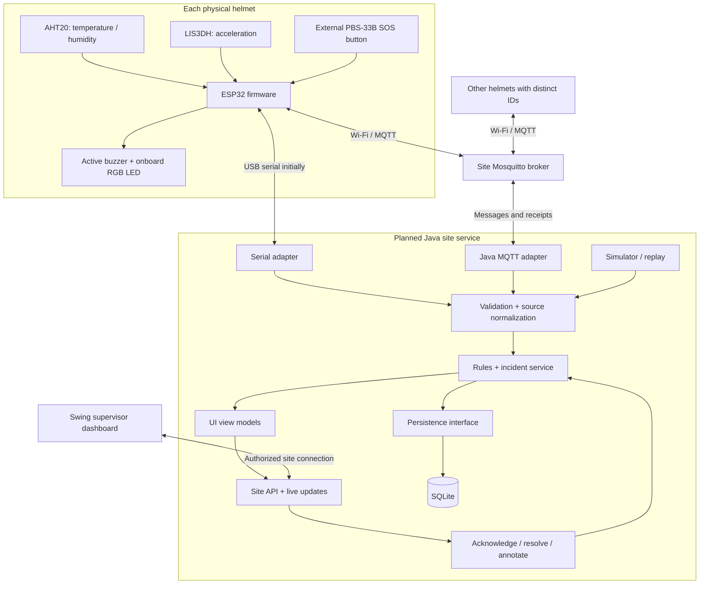
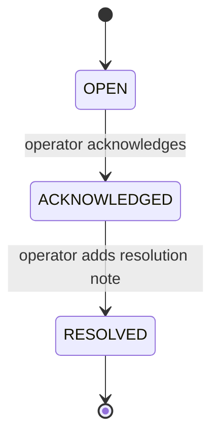

# System design

This is the proposed design. Validate it through the roadmap milestones and record changes as the team learns from the hardware.

The November 14 [hardware selection](HARDWARE.md) uses S3 N16R8, AHT20/BMP280, LIS3DH, onboard RGB, an active-low buzzer, and an external PBS-33B SOS button. The intended product monitors many workers and helmets; the course prototype will use one physical helmet and labeled simulated helmets. The existing Java application supports only one simulated source and is not yet a central server. Verify the clone pin map, USB behavior, non-strapping SOS input, and mounted button access. The reported order does not demonstrate physical integration.

## Components



**Target, not implemented:** the site runs a Java monitoring service and an MQTT broker on a site computer or server. Helmets connect over the site network; a Swing dashboard consumes the service's API and live updates. The transport for dashboard updates and API contract are still to be chosen and reviewed. A single local laptop may host all components for the course demo. SQLite is a starting point for that single service; deployment size, capacity, and any later database migration must be measured and justified. This is not a claim of production scale, internet availability, or independent services today.

Each helmet has a unique device ID. A time-bounded assignment links that ID to one worker for the current shift; use fictional names in demos. The dashboard needs a worker list, per-helmet last reading, stale/offline state, sensor fault, SOS/motion incidents, and independent history. Reassignments must not relabel old incidents. A helmet without an assignment is shown as unassigned. Test duplicate and out-of-order messages independently per device. Limit access to worker data, protect device identities and credentials, and record only the data needed for the demo. TLS and per-device authorization are required before an internet-exposed deployment; the private-LAN prototype remains a controlled demonstration.

The AHT20 reports the air temperature and relative humidity near its mounting position, not a worker's core body temperature. It does not establish heat illness or workplace safety. Sensor position, sunlight, enclosure heat, and calibration affect readings. If body-temperature measurement is requested, treat it as a separate sensor and validation decision, not a feature of the ordered AHT20.

**Location:** no GNSS/GPS module was included in the reported order, and neither the current software nor hardware can provide GPS coordinates. The first multi-worker UI may use an operator-assigned site/zone label as manually entered information, with an update time and clear manual provenance. This is not automatic tracking. GPS, indoor positioning, hardware choice, costs, privacy, permissions, and accuracy are separate decisions; never fabricate coordinates or a live location.

Firmware reads sensors, handles button debounce, and runs local alarm logic. It emits explicit SOS and sudden-motion events; Java uses those events to create incidents. Java evaluates environmental incident rules from readings and stores their evidence. Both sides use the same agreed threshold configuration, but only Java manages operator incident states.

Local alarms must not depend on broker availability, Java uptime, or a database commit. Avoid a network operation blocking the sampling or button loop. The desired sampling rates are a design starting point: environmental data and telemetry around 1 Hz, with motion sampling fast enough to capture short movements. Jakhongir will select and measure the actual motion rate during S02 rather than inferring it from a 1 Hz dashboard.

## Java boundaries

| Boundary | Responsibility | Must not depend on |
| --- | --- | --- |
| Domain | Reading/event types, validation rules, incident states, threshold evaluation | Swing widgets, MQTT clients, JDBC connections |
| Application | Ingestion, deduplication, incident commands, receipts, export coordination | Concrete network or database implementations |
| Input/output adapters | MQTT, serial, simulation, replay, SQLite repositories | UI state |
| UI | Status cards, trend views, incident filters, operator actions | MQTT parsing or handwritten SQL |

The current prototype is one Maven desktop application. A future service/client split should retain these boundaries: server-side ingestion/rules/storage and a dashboard connected through a reviewed API. First prove multiple labeled simulated sources within the existing app; then extract the service and add remote-dashboard communication. Freeze small interfaces before splitting work among members.

Proposed folders after S01/S02:

```text
desktop/        Java application, resources, tests, and Maven wrapper
firmware/       ESP32 source, library versions, and board configuration
config/         Sanitized examples for broker and application configuration
fixtures/       Synthetic protocol examples and deterministic replay scenarios
docs/           Design, roadmap, team plan, and verification instructions
evidence/       Sanitized measurements and screenshots after testing
```

The `desktop/` prototype now exists. Firmware, broker configuration, shared fixtures, and physical evidence remain to be implemented.

## Message handling

1. An adapter receives a bounded payload. Reject malformed JSON, unsupported versions, non-finite numbers, or invalid field combinations.
2. Normalize the payload into a typed domain input. Keep its device ID, boot/session ID, sequence number, source mode, and receive time.
3. For live input, update device health. Recorded replay and stale retained messages must not mark a physical device as live.
4. Process the source event and incident changes in one SQLite transaction. Apply unique keys to suppress duplicates.
5. Send a Java receipt for a hardware event only after commit. A retry of an already committed event gets another receipt without another incident.
6. Publish a view-model update on the Swing event thread. Network I/O, file export, and database access remain in background workers.

The receipt confirms Java accepted a record. It does not mean an operator saw the incident or that a warning condition is safe.

## Incidents and device health



Every transition records a time and operator label. Notes are added as new history entries. The first version does not edit or delete previous actions, reopen incidents, or skip directly from OPEN to RESOLVED. Resolving an incident is an operator record, not a measurement of safety.

Device health is separate from incident state. A device may be connected while an SOS incident is still open. Disconnection must not resolve an incident. Clearing a local alarm and acknowledging an incident are also separate operations; no remote command may silently disable the SOS button.

Treat a device as stale when valid live readings have not arrived for 5 seconds, and refresh health at least once per second. This supports the proposal's target of showing stale status within 6 seconds. Broker connection state and last-will messages can give earlier hints, but do not replace reading-age checks.

## Storage plan

| Table | Purpose and important constraints |
| --- | --- |
| `devices` | Stable fictional device ID and display name; no worker personal data needed |
| `workers` and `helmet_assignments` | Demo worker identity and time-bounded helmet assignment; historical incidents retain the assignment active when recorded |
| `sessions` | Device ID and boot ID; separate reconnects from firmware restarts |
| `readings` | Sample values, sensor health, receive time, uptime, source mode; unique device/boot/sequence tuple |
| `source_events` | Unique hardware event identity, event type, payload, and commit time |
| `incidents` | Type, severity, device, state, and unique source/rule identity |
| `incident_actions` | Append-only acknowledgement, note, and resolution records linked to an incident |

Use JDBC transactions for event ingestion and operator actions. Enable SQLite foreign keys on every connection, and keep schema changes in numbered migrations. A unique source identity must make deduplication survive application restart. Store sampled readings at a documented rate; do not write every high-rate motion sample indefinitely.

Device uptime is useful within one boot session. Java receive timestamps provide history on the laptop. Do not subtract unrelated device and laptop clocks to claim latency. The SOS receipt test measures elapsed time entirely on the ESP32.

## Failure behavior

| Failure | Planned behavior |
| --- | --- |
| Sensor missing or invalid | Report the affected sensor as faulty; do not substitute a plausible reading |
| Wi-Fi or broker down | Keep local alarms; show stale/disconnected state in Java |
| Java process down | Keep helmet alarms; recover committed incident history after restart |
| SQLite write fails | Show a storage fault and withhold the durable event receipt; never claim the incident was saved |
| Duplicate event | Return the existing receipt after checking its committed identity; do not create another incident |
| Firmware restarts | Use a new boot ID so sequence reuse does not overwrite old records |
| Delayed or replayed input | Label it as historical/simulated and preserve chronology; do not claim the device is currently live |

In the baseline, remote delivery of events generated during a network outage is not guaranteed. The optional offline queue must define its capacity, replay order, receipt handling, and power-loss behavior before that guarantee changes.

## Configuration and access

Start on a private demonstration LAN with an authenticated local broker and a restricted service/dashboard connection. Keep Wi-Fi credentials and broker passwords in ignored local configuration. Implement TLS and per-device topic permissions before internet exposure; neither is implemented yet. Avoid retaining personal and location data beyond what is needed for the project.

Java may send a versioned configuration command. Firmware validates supported values and replies with the accepted version or a rejection. Document both sides' defaults. Do not assume a setting took effect just because MQTT accepted its publication.

## References

- [ESP32-S3-DevKitC-1 reference-board guide](https://docs.espressif.com/projects/esp-idf/en/v4.4.3/esp32s3/hw-reference/esp32s3/user-guide-devkitc-1.html); verify the purchased clone's revision.
- [Espressif MQTT documentation](https://docs.espressif.com/projects/esp-idf/en/stable/esp32/api-reference/protocols/mqtt.html) for protocol capabilities; this does not choose the Arduino firmware library.
- [Eclipse Paho Java](https://eclipse.dev/paho/clients/java/index.html)
- [Mosquitto authentication](https://mosquitto.org/documentation/authentication-methods/)
- [SQLite foreign keys](https://www.sqlite.org/foreignkeys.html)
